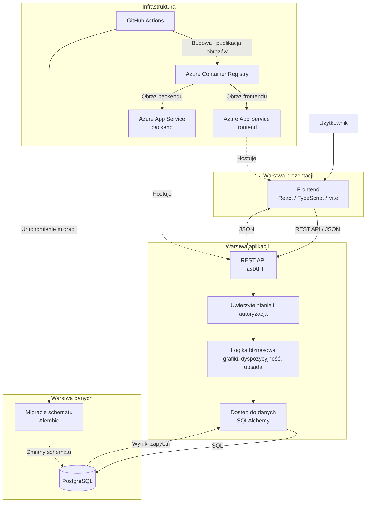

# DreamPlanner

DreamPlanner służy do planowania dyspozycyjności pracowników i zleceniobiorców oraz układania miesięcznych grafików pracy. Administrator zarządza kontami i stanowiskami, manager tworzy grafiki, zbiera dyspozycyjność, obsadza zmiany i publikuje grafik, a pracownik zgłasza dostępność i przegląda swoje opublikowane zmiany.

## Technologie i architektura

| Warstwa | Technologie |
| --- | --- |
| Frontend | React, TypeScript, Vite |
| Backend | Python 3.12, FastAPI, Pydantic, SQLAlchemy, Alembic, JWT |
| Baza danych | PostgreSQL 16 lokalnie, Azure Database for PostgreSQL Flexible Server w Azure |
| Infrastruktura | Docker Compose, Docker, Azure App Service, Azure Container Registry, Azure Key Vault, GitHub Actions, Terraform |

Backend ma moduły funkcjonalne: routery obsługują HTTP, serwisy reguły biznesowe, a SQLAlchemy dostęp do danych. Alembic zarządza migracjami. Frontend wysyła żądania REST z przeglądarki. Chronione operacje używają JWT w nagłówku `Authorization: Bearer <token>`. Sesje są przechowywane w PostgreSQL, a token odświeżania w ciasteczku HttpOnly.



Diagram pokazuje logiczny przepływ danych. W Azure frontend i backend działają w osobnych App Service. Przeglądarka wywołuje publiczne API backendu przez HTTPS. Backend używa prywatnego połączenia z PostgreSQL.

## Endpointy API

Wszystkie ścieżki tabel mają prefiks `/api/v1`. "Zalogowany" oznacza ważny Bearer JWT i sesję. Logowanie oraz odświeżanie wymagają dozwolonego nagłówka `Origin`, operacje z ciasteczkiem sesji też podlegają tej kontroli. Pełny kontrakt, parametry list i odpowiedzi błędów są w `/docs` i `/openapi.json`.

### Stan usługi i uwierzytelnianie

| Metoda HTTP | Endpoint | Opis | Dostęp |
| --- | --- | --- | --- |
| `GET` | `/health` | Stan procesu API | Publiczny |
| `GET` | `/health/ready` | Gotowość API i bazy | Publiczny |
| `POST` | `/auth/sessions` | Logowanie, access JWT i refresh cookie | Publiczny; dozwolony `Origin` |
| `POST` | `/auth/sessions/current/refresh` | Odnowienie sesji z refresh cookie | Refresh cookie; dozwolony `Origin` |
| `DELETE` | `/auth/sessions/current` | Wylogowanie z bieżącej sesji | Zalogowany; dozwolony `Origin` |
| `DELETE` | `/auth/sessions` | Wylogowanie ze wszystkich sesji | Zalogowany; dozwolony `Origin` |
| `POST` | `/auth/activations` | Aktywacja konta kodem i ustawienie hasła | Publiczny; kod aktywacyjny |
| `POST` | `/auth/reactivations` | Reaktywacja konta kodem i nowe hasło | Publiczny; kod reaktywacji |

### Użytkownicy i stanowiska

| Metoda HTTP | Endpoint | Opis | Dostęp |
| --- | --- | --- | --- |
| `GET` | `/users/me` | Własny profil | Zalogowany |
| `POST` | `/users/me/password-change` | Zmiana własnego hasła | Zalogowany |
| `GET` | `/users` | Lista kont | `admin` |
| `GET` | `/users/{user_id}` | Szczegóły konta | `admin` |
| `POST` | `/users` | Nowe konto i kod aktywacyjny | `admin` |
| `PUT` | `/users/{user_id}/role` | Zmiana roli | `admin` |
| `POST` | `/users/{user_id}/deactivation` | Dezaktywacja konta | `admin` |
| `POST` | `/users/{user_id}/reactivation` | Kod reaktywacji | `admin` |
| `POST` | `/users/{user_id}/activation-tokens` | Ponowny kod aktywacji | `admin` |
| `GET` | `/employees` | Pracownicy do obsady | `admin`, `manager` |
| `GET` | `/positions` | Lista stanowisk | `admin`, `manager` |
| `GET` | `/positions/{position_id}` | Szczegóły stanowiska | `admin`, `manager` |
| `POST` | `/positions` | Nowe stanowisko | `admin` |
| `PATCH` | `/positions/{position_id}` | Zmiana nazwy | `admin` |
| `POST` | `/positions/{position_id}/deactivation` | Dezaktywacja stanowiska | `admin` |
| `POST` | `/positions/{position_id}/reactivation` | Reaktywacja stanowiska | `admin` |

### Grafiki i zapotrzebowanie

| Metoda HTTP | Endpoint | Opis | Dostęp |
| --- | --- | --- | --- |
| `GET` | `/schedules` | Lista grafików | `admin`, `manager` |
| `GET` | `/schedules/{schedule_id}` | Szczegóły grafiku | `admin`, `manager` |
| `POST` | `/schedules` | Nowy grafik miesięczny (`draft`) | `manager` |
| `DELETE` | `/schedules/{schedule_id}` | Trwałe usunięcie grafiku i danych zależnych | `admin`, `manager` |
| `POST` | `/schedules/{schedule_id}/collection-opening` | Otwarcie zbierania dyspozycyjności | `manager` |
| `POST` | `/schedules/{schedule_id}/collection-closing` | Zamknięcie zbierania | `manager` |
| `POST` | `/schedules/{schedule_id}/closing` | Przejście do obsadzania | `manager` |
| `POST` | `/schedules/{schedule_id}/publication` | Publikacja grafiku | `manager` |
| `GET` | `/me/schedules` | Grafiki zbierające dyspozycyjność | `employee` |
| `GET` | `/schedules/{schedule_id}/shift-requirements` | Lista zapotrzebowań | `admin`, `manager` |
| `GET` | `/schedules/{schedule_id}/shift-requirements/{requirement_id}` | Szczegóły zapotrzebowania | `admin`, `manager` |
| `POST` | `/schedules/{schedule_id}/shift-requirements` | Zapotrzebowanie w szkicu | `manager` |
| `PATCH` | `/schedules/{schedule_id}/shift-requirements/{requirement_id}` | Edycja w szkicu | `manager` |
| `DELETE` | `/schedules/{schedule_id}/shift-requirements/{requirement_id}` | Usunięcie w szkicu | `manager` |

Etapy grafiku: `draft` -> `collecting` -> `collection_closed` -> `closed` -> `published`.

### Dyspozycyjność i obsada

| Metoda HTTP | Endpoint | Opis | Dostęp |
| --- | --- | --- | --- |
| `GET` | `/schedules/{schedule_id}/availability-submissions` | Lista zgłoszeń | `admin`, `manager`; `employee` tylko własne |
| `GET` | `/schedules/{schedule_id}/availability-submissions/{submission_id}` | Zgłoszenie z przedziałami godzin | `admin`, `manager`; `employee` tylko własne |
| `POST` | `/schedules/{schedule_id}/availability-submissions` | Nowe zgłoszenie podczas `collecting` | `employee` |
| `PATCH` | `/schedules/{schedule_id}/availability-submissions/{submission_id}` | Zmiana lub wysłanie zgłoszenia | `employee`, tylko własne |
| `DELETE` | `/schedules/{schedule_id}/availability-submissions/{submission_id}` | Usunięcie własnej wersji roboczej | `employee` |
| `GET` | `/schedules/{schedule_id}/shift-assignments` | Przydziały w grafiku | `admin`, `manager` |
| `GET` | `/schedules/{schedule_id}/shift-assignments/{assignment_id}` | Szczegóły przydziału | `admin`, `manager` |
| `POST` | `/schedules/{schedule_id}/shift-assignments` | Przydzielenie pracownika | `manager` |
| `DELETE` | `/schedules/{schedule_id}/shift-assignments/{assignment_id}` | Usunięcie przydziału | `manager` |
| `GET` | `/me/shifts` | Własne opublikowane zmiany | `employee` |
| `GET` | `/me/shifts/{assignment_id}` | Szczegóły własnej zmiany | `employee` |

### Przykładowe JSON i kody odpowiedzi

Logowanie: `POST /api/v1/auth/sessions` z dozwolonym `Origin` -> `200 OK` (odpowiedź ustawia także refresh cookie):

```json
{"email":"anna@example.com","password":"przykladowe-haslo"}
```

```json
{"access_token":"<JWT>","token_type":"bearer","expires_in":600}
```

Utworzenie grafiku: `POST /api/v1/schedules` z Bearer JWT managera -> `201 Created`:

```json
{"year":2026,"month":11}
```

```json
{"id":"1","year":2026,"month":11,"status":"draft","created_by":"2","created_at":"2026-10-31T10:00:00Z","collection_opened_at":null,"collection_closed_at":null,"published_at":null}
```

Zapotrzebowanie: `POST /api/v1/schedules/1/shift-requirements` z Bearer JWT managera -> `201 Created`. Daty mają format `YYYY-MM-DD`, godziny `HH:MM:SS`.

```json
{"position_id":"3","work_date":"2026-11-05","start_time":"09:00:00","end_time":"17:00:00","required_workers":2,"note":null}
```

```json
{"id":"4","schedule_id":"1","position_id":"3","position_name":"Obsługa klienta","position_is_active":true,"work_date":"2026-11-05","start_time":"09:00:00","end_time":"17:00:00","required_workers":2,"note":null}
```

Dyspozycyjność: `POST /api/v1/schedules/1/availability-submissions` z Bearer JWT pracownika podczas `collecting` -> `201 Created`:

```json
{"entries":[{"work_date":"2026-11-05","start_time":"09:00:00","end_time":"17:00:00","status":"available","note":null}],"submit":true}
```

```json
{"id":"5","schedule_id":"1","user_id":"6","submitted_at":"2026-11-01T08:00:00Z","created_at":"2026-11-01T08:00:00Z","updated_at":"2026-11-01T08:00:00Z","entries":[{"id":"7","work_date":"2026-11-05","start_time":"09:00:00","end_time":"17:00:00","status":"available","note":null}]}
```

Przydział: `POST /api/v1/schedules/1/shift-assignments` z Bearer JWT managera w etapie `closed` -> `201 Created`:

```json
{"shift_requirement_id":"4","user_id":"6","warning_acknowledged":false}
```

```json
{"id":"8","schedule_id":"1","shift_requirement_id":"4","user_id":"6","assigned_by":"2","assigned_at":"2026-11-02T09:00:00Z","warning_type":null,"warning_acknowledged_at":null,"work_date":"2026-11-05","start_time":"09:00:00","end_time":"17:00:00"}
```

Identyfikatory i znaczniki czasu w przykładach są ilustracyjne. Listy zwracają `items`, `limit`, `offset`, `total`. Operacje bez treści, np. wylogowanie i usunięcie przydziału, zwracają `204 No Content` bez JSON.

| Kod HTTP | Znaczenie |
| --- | --- |
| `200` | Udany odczyt, aktualizacja lub zmiana etapu |
| `201` | Utworzenie zasobu |
| `204` | Sukces bez treści odpowiedzi |
| `400` | Niepoprawna składnia JSON |
| `401` | Brak lub nieważne uwierzytelnienie, błędne dane logowania albo kod |
| `403` | Brak uprawnień lub niedozwolony `Origin` |
| `404` | Zasób nie istnieje lub jest niedostępny dla użytkownika |
| `409` | Konflikt reguł lub stanu, np. zajęty miesiąc albo pełna obsada |
| `422` | Błędne dane wejściowe lub parametry |
| `429` | Limit prób operacji uwierzytelniania |
| `500` | Nieoczekiwany błąd serwera |
| `503` | Brak gotowości bazy albo konfiguracji uwierzytelniania |

Błędy używają `application/problem+json`, np. `403 Forbidden`:

```json
{"type":"about:blank","title":"Odmowa dostępu","status":403,"detail":"Brak uprawnienia."}
```

## Uruchomienie lokalne

Opisany wariant uruchamia PostgreSQL w Docker Compose, backend na hoście i frontend przez Vite. Backend i frontend uruchom w **osobnych terminalach**.

### Wymagania wstępne

- Python 3.12 i `uv` do obsługi backendu.
- Docker z Compose do uruchomienia PostgreSQL. Obraz w `backend/compose.yaml` to PostgreSQL 16.15. Można użyć własnej lokalnej bazy, podając odpowiednie adresy połączenia.
- Node.js 22 i npm do obsługi frontendu.

Sklonuj projekt i przejdź do jego katalogu:

```sh
git clone https://github.com/KacperPolarczyk/DreamPlanner.git
cd DreamPlanner
```

### Uruchomienie backendu

W pierwszym terminalu wykonaj poniższe kroki.

1. Przejdź do `backend/`, skopiuj szablon `.env` i wygeneruj klucz JWT:

   ```sh
   cd backend
   cp .env.example .env
   openssl rand -base64 32
   ```

   W `backend/.env` ustaw trzy różne lokalne hasła, dopasuj je w `DATABASE_URL` i `MIGRATION_DATABASE_URL`, a wygenerowany klucz wpisz jako `JWT_SIGNING_KEY_BASE64`. Zachowaj `http://localhost:5173` w `CORS_ORIGINS`. Nie dodawaj `.env` do repozytorium. Przy istniejącym wolumenie PostgreSQL zmiana wartości w `.env` nie zmienia haseł już utworzonych ról.

2. Zainstaluj zależności, uruchom bazę i wykonaj migracje:

   ```sh
   uv sync
   docker compose up -d --wait postgres
   uv run alembic upgrade head
   ```

3. Przy pierwszym uruchomieniu utwórz administratora - polecenie poprosi o hasło w terminalu:

   ```sh
   uv run python -m src.users.bootstrap_admin --email admin@example.com --full-name "Anna Nowak"
   ```

4. Uruchom API i pozostaw ten terminal otwarty:

   ```sh
   uv run uvicorn src.main:app --host 127.0.0.1 --port 8000 --workers 1 --no-proxy-headers
   ```

   Migracje nie uruchamiają się automatycznie przy starcie API.

### Uruchomienie frontendu

W drugim terminalu, z katalogu głównego projektu:

1. Przejdź do `frontend/` i skopiuj szablon konfiguracji:

   ```sh
   cd frontend
   cp .env.example .env.local
   ```

   W `frontend/.env.local` ustaw `VITE_API_BASE_URL=http://127.0.0.1:8000/api/v1`. Zmienne `VITE_` są wbudowywane w frontend, więc nie umieszczaj w nich sekretów. Adres frontendu musi być dozwolony przez backendowe `CORS_ORIGINS`.

2. Zainstaluj zależności i uruchom serwer Vite:

   ```sh
   npm ci
   npm run dev
   ```

### Adresy aplikacji

| Usługa | Adres lokalny |
| --- | --- |
| Frontend | `http://localhost:5173` |
| Backend API | `http://127.0.0.1:8000` |
| Swagger UI | `http://127.0.0.1:8000/docs` |
| OpenAPI JSON | `http://127.0.0.1:8000/openapi.json` |

Szczegółowe warianty uruchomienia backendu opisuje [backend/README.md](backend/README.md). Więcej o interfejsie i Vite: [frontend/README.md](frontend/README.md).

## Testowanie

Z katalogu `backend/`:

```sh
uv run pytest -m 'not integration'
uv run ruff check .
uv run ruff format --check .
```

`uv run pytest` obejmuje także testy `integration`, wymagające osobnej testowej bazy PostgreSQL. Z katalogu `frontend/` dostępne są `npm run lint` oraz `npm run build` (TypeScript i build Vite). `package.json` nie definiuje obecnie skryptu testów frontendu.

## CI/CD

Workflow [backend Azure](.github/workflows/backend-azure.yml) na pull requestach do `main` i po zmianach backendu na `main` wykonuje Ruff, kontrolę formatowania i testy bez grupy `integration`. Po udanych kontrolach na `main` publikuje obraz w Azure Container Registry, uruchamia migracje przed wdrożeniem, aktualizuje backend w App Service i sprawdza `/api/v1/health/ready`. Workflow [frontend Azure](.github/workflows/frontend-azure.yml) reaguje na zmiany frontendu na `main`: buduje obraz z `npm run build`, wysyła go do rejestru i aktualizuje frontend w App Service. Oba workflow można uruchomić ręcznie na `main` i używają GitHub OIDC. Zmiana samego głównego README nie uruchamia tych workflow.
