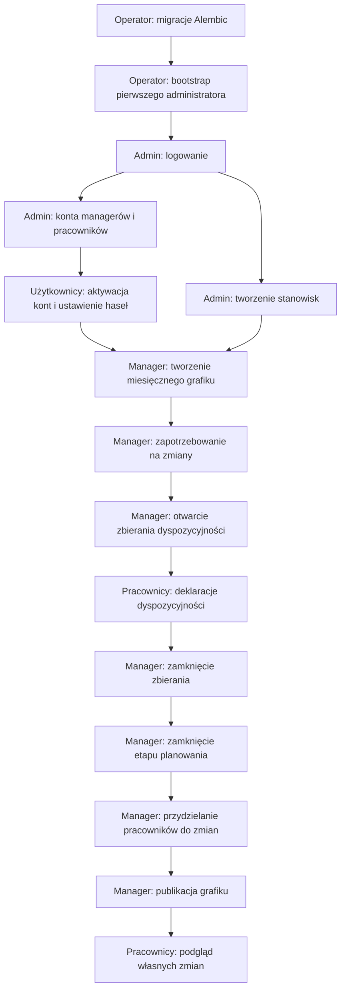
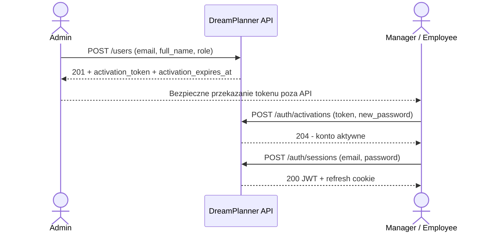
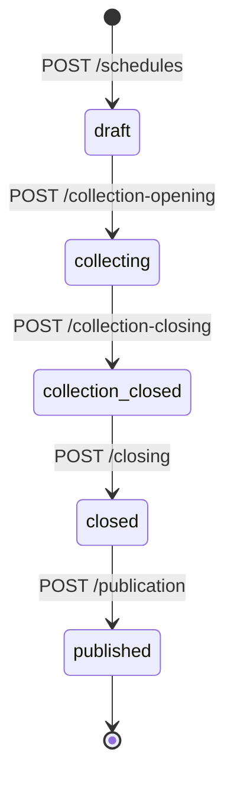

# DreamPlanner - przepływ pracy i korzystanie z REST API

> Dokumentacja została przygotowana na podstawie aktualnego backendu z dnia 25.10.2026. Opisuje AKTUALNIE zaimplementowane zachowanie, a nie planowane funkcje. Wszystkie ścieżki mają prefiks `/api/v1`.

## 1. Przegląd procesu



## 2. Role i odpowiedzialność

| Operacja | Admin | Manager | Employee |
|---|:---:|:---:|:---:|
| Zarządzanie kontami, rolami i tokenami aktywacyjnymi | ✓ | - | - |
| Tworzenie/edycja/dezaktywacja stanowisk | ✓ | - | - |
| Odczyt stanowisk i grafików | ✓ | ✓ | - |
| Tworzenie grafików i zapotrzebowania | - | ✓ | - |
| Zmiana etapów grafiku i publikacja | - | ✓ | - |
| Odczyt deklaracji dyspozycyjności | Wszystkie | Wszystkie | Własne |
| Zapis własnej dyspozycyjności | - | - | ✓ |
| Tworzenie/usuwanie przydziałów | - | ✓ | - |
| Odczyt własnych opublikowanych zmian | - | - | ✓ |
| Własny profil, zmiana hasła, sesje | ✓ | ✓ | ✓ |

Zmiana roli jest odczytywana z bazy przy autoryzacji kolejnych żądań. Manager może modyfikować grafiki utworzone przez innych managerów; nie ma ograniczenia do autora grafiku.

## 3. Pierwsze uruchomienie

### 3.1. Migracje (operator, poza działającą aplikacją)

Po skonfigurowaniu `MIGRATION_DATABASE_URL` dla konta migracyjnego, w katalogu `backend/`:

```bash
uv sync --frozen --no-dev
uv run --no-sync alembic upgrade head
uv run --no-sync alembic current
```

Oczekiwana rewizja na dzień sporządzenia dokumentacji: `20261023_02 (head)`. Nie uruchamiać lokalnych skryptów `docker/init-roles.sh` na Azure - konta bazy tworzy DBA.

### 3.2. Pierwszy administrator (operator)

Po ustawieniu `DATABASE_URL` konta aplikacyjnego:

```bash
uv run --no-sync python -m src.users.bootstrap_admin \
  --email 'admin@example.com' \
  --full-name 'Administrator DreamPlanner'
```

Skrypt interaktywnie pyta o hasło i jego potwierdzenie. Tworzy aktywne konto z rolą `admin`; odmawia, jeżeli aktywny administrator już istnieje. Hasła ani wartości `DATABASE_URL` nie umieszczać w repozytorium i logach.

## 4. Konta użytkowników: admin → manager / employee



1. Administrator loguje się przez `POST /auth/sessions` i uzyskuje access token.
2. Administrator tworzy konto: `POST /users`, np.:

```json
{
  "email": "manager@example.com",
  "full_name": "Jan Kowalski",
  "role": "manager"
}
```

3. API zwraca `201 CreatedUserResponse` wraz z **jednorazowo ujawnionym** `activation_token` i `activation_expires_at`. Nowe konto jest początkowo nieaktywne; token jest ważny 24 godziny.
4. Administrator przekazuje token właściwej osobie bezpiecznym, uzgodnionym kanałem. **Backend nie wysyła e-maili automatycznie.**
5. Użytkownik aktywuje konto:

```http
POST /api/v1/auth/activations
Content-Type: application/json
```

```json
{
  "token": "TOKEN_PRZEKAZANY_UZYTKOWNIKOWI",
  "new_password": "SILNE_HASLO_UZYTKOWNIKA"
}
```

6. Użytkownik loguje się przez `POST /auth/sessions` i może korzystać z uprawnień swojej roli.

**Pozostałe operacje administratora:** `GET /users`, `GET /users/{user_id}`, `POST /users/{user_id}/activation-tokens` (nowy token dla oczekującego konta), `PUT /users/{user_id}/role`, `POST /users/{user_id}/deactivation`, `POST /users/{user_id}/reactivation`. Kolejne konto z rolą `admin` powstaje przez zmianę roli istniejącego konta, nie przez `POST /users`. Administrator nie może odebrać uprawnień ani dezaktywować ostatniego aktywnego administratora; nie może również zmienić własnej roli ani dezaktywować siebie.

**Reaktywacja:** admin wydaje `reactivation_token`, a użytkownik ustawia nowe hasło przez `POST /auth/reactivations`. Token jest ważny 24 godziny. Nie ma publicznego „zapomniałem hasła”.

## 5. Stanowiska (admin)

Stanowisko to typ pracy wymagany przy definiowaniu obsady zmiany (np. „Kasjer”, „Magazynier”).

1. `POST /positions` z `{"name":"Kasjer"}` - tworzy aktywne stanowisko.
2. `GET /positions` - lista (admin, manager), `GET /positions/{position_id}` - szczegóły.
3. `PATCH /positions/{position_id}` - zmiana nazwy (admin).
4. `POST /positions/{position_id}/deactivation` i `/reactivation` - wyłączenie lub przywrócenie stanowiska (admin).

Nazwa po przycięciu ma 1–120 znaków; unikalność rozróżnia wielkość liter i obejmuje stanowiska nieaktywne. Nowe zapotrzebowanie wymaga aktywnego stanowiska. Dezaktywacja nie usuwa historycznych powiązań.

## 6. Grafik miesięczny i zapotrzebowanie (manager)

### 6.1. Cykl życia grafiku



Wszystkie przejścia stanów mają prefiks `/schedules/{schedule_id}`. W stanie `draft` manager może również usunąć pusty grafik przez `DELETE /schedules/{schedule_id}`. API nie udostępnia cofania grafiku z `published`.

### 6.2. Utworzenie grafiku i zapotrzebowania

1. `POST /schedules` z `{"year":2026,"month":11}` - nowy grafik w stanie `draft`.
2. `POST /schedules/{schedule_id}/shift-requirements` - zdefiniowanie obsady, np.:

```json
{
  "position_id": "1",
  "work_date": "2026-11-03",
  "start_time": "09:00:00",
  "end_time": "17:00:00",
  "required_workers": 2,
  "note": "Zmiana poranna"
}
```

Przykład ilustruje strukturę pól; konkretne ID i walidację należy sprawdzić w Swagger/OpenAPI. Zapotrzebowanie można edytować (`PATCH`) i usuwać (`DELETE`) tylko w `draft`; po utworzeniu przydziału nie można zmienić struktury ani usunąć powiązanego zapotrzebowania. Data musi należeć do miesiąca grafiku, `start_time` musi być wcześniejszy niż `end_time`, a dokładne duplikaty są odrzucane. Wymagana jest prawidłowa lokalna godzina w strefie `Europe/Warsaw`.
3. `POST /schedules/{schedule_id}/collection-opening` - przejście do `collecting`.

## 7. Dyspozycyjność (employee)

Pracownik zgłasza dyspozycyjność **wyłącznie podczas `collecting`**. Może mieć jedną deklarację na grafik, zawierającą listę wpisów z polami `work_date`, `start_time`, `end_time`, `status` (`available` / `unavailable`) i opcjonalnym `note`.

- `POST /schedules/{schedule_id}/availability-submissions` - utworzenie deklaracji; `submit` domyślnie `false` (szkic).
- `PATCH /schedules/{schedule_id}/availability-submissions/{submission_id}` - zastąpienie całej listy `entries` lub `submit: true`.
- `DELETE /schedules/{schedule_id}/availability-submissions/{submission_id}` - usunięcie tylko szkicu.
- `GET /schedules/{schedule_id}/availability-submissions` - pracownik widzi tylko własną deklarację, admin i manager mogą przeglądać wszystkie.

Wpisy nie mogą się nakładać. Przesłaną deklarację można jeszcze edytować, dopóki grafik jest w `collecting`. Po zamknięciu zbierania nie można jej zmieniać.

## 8. Przydziały i publikacja (manager)

1. Manager kończy zbieranie: `POST /schedules/{schedule_id}/collection-closing` → `collection_closed`.
2. Zamyka etap planowania: `POST /schedules/{schedule_id}/closing` → `closed`.
3. Sprawdza listę aktywnych pracowników przez `GET /employees` i deklaracje dyspozycyjności.
4. Dodaje przydziały **tylko w `closed`**:

```http
POST /api/v1/schedules/{schedule_id}/shift-assignments
Content-Type: application/json
Authorization: Bearer <JWT_MANAGERA>
```

```json
{
  "shift_requirement_id": "1",
  "user_id": "3",
  "warning_acknowledged": false
}
```

Przydział wymaga aktywowanego pracownika, wolnego miejsca w `required_workers`, braku duplikatu i nakładających się zmian. Gdy dyspozycyjność ma stan `unavailable` lub `unknown`, manager musi jawnie ustawić `warning_acknowledged: true`; system zapisuje potwierdzenie ostrzeżenia. Manager może usuwać przydziały w `closed`.
5. `POST /schedules/{schedule_id}/publication` → `published`. Publikacja dopuszcza niepełną obsadę; po publikacji API nie pozwala dodawać przydziałów.
6. Pracownik widzi własne opublikowane zmiany przez `GET /me/shifts?from_date=2026-11-01&to_date=2026-11-30` oraz `GET /me/shifts/{assignment_id}`.

## 9. Logowanie i sesje

- `POST /auth/sessions`: e-mail i hasło → access JWT (10 minut) oraz refresh token w cookie `HttpOnly`.
- `POST /auth/sessions/current/refresh`: rotacja refresh tokenu; bez treści JSON.
- `DELETE /auth/sessions/current`: wylogowanie jednej sesji.
- `DELETE /auth/sessions`: wylogowanie wszystkich sesji.
- `GET /users/me`: profil bieżącego użytkownika.
- `POST /users/me/password-change`: zmiana hasła, unieważnia wszystkie sesje.

Access JWT jest wysyłany w `Authorization: Bearer <token>`. Backend sprawdza także sesję i bieżący stan użytkownika w PostgreSQL. Refresh ma limit bezczynności 24 godziny i maksymalny czas życia sesji 7 dni.

## 10. Zasady testowania API na Azure

1. Otwórz `/docs` wdrożonego App Service; najpierw sprawdź `/health/ready`.
2. Przetestuj logowanie administratora, `GET /users/me`, utworzenie managera i pracownika, aktywację kont oraz utworzenie stanowiska.
3. Zaloguj managera i przeprowadź cały cykl `draft → collecting → collection_closed → closed → published`.
4. Podczas `collecting` zaloguj pracownika i prześlij deklarację dyspozycyjności.
5. W `closed` dodaj przydział; po publikacji zweryfikuj `GET /me/shifts` jako pracownik.
6. Sprawdź odmowę dostępu (`403`) dla operacji spoza roli i brak dostępu do cudzych danych pracownika.

**Uwaga wdrożeniowa:** aktualny obraz startuje z `uvicorn --no-proxy-headers`. Jeżeli Azure przekazuje ruch HTTP do kontenera po terminacji TLS, `require_https` może odrzucać logowanie/aktywację. Ponadto operacje sesyjne wymagają poprawnego nagłówka `Origin` należącego do `CORS_ORIGINS`; przy `CORS_ORIGINS=[]` testy logowania mogą zostać zablokowane. Przed testami należy zweryfikować bezpieczną konfigurację zaufanych proxy i dozwolonych originów, a nie wyłączać kontroli HTTPS.

## 11. Ograniczenia obecnej implementacji

- Tokeny aktywacji i reaktywacji są przekazywane ręcznie; brak automatycznej wysyłki e-maili.
- Admin nie tworzy ani nie publikuje grafików - robi to manager.
- Nie można edytować przydziałów po publikacji ani cofnąć publikacji w obecnym API.
- Limity prób są przechowywane w pamięci procesu (`memory://`), a więc nie są współdzielone pomiędzy instancjami.
- `/health/ready` potwierdza połączenie SQL (`SELECT 1`), ale nie sprawdza wersji migracji, konfiguracji JWT ani uprawnień biznesowych.
- Pełny zestaw testów HTTP i integracyjnych nie został potwierdzony jako zaliczony w raporcie Codexa; raport potwierdza 36 testów wybranych modułów oraz pomyślne kontrole Ruff.

## 12. Gdzie szukać implementacji

| Obszar | Kod |
|---|---|
| Rejestracja routerów | `src/api.py` |
| Logowanie i sesje | `src/auth/router.py`, `src/auth/session_service.py` |
| Bootstrap i konta | `src/users/bootstrap_admin.py`, `src/users/router.py`, `src/users/account_service.py` |
| Role i autoryzacja | `src/auth/dependencies.py`, `src/users/admin_service.py` |
| Stanowiska | `src/positions/router.py`, `src/positions/service.py` |
| Grafiki i zapotrzebowanie | `src/schedules/router.py`, `src/schedules/service.py` |
| Dyspozycyjność | `src/availability/router.py`, `src/availability/service.py` |
| Przydziały | `src/assignments/router.py`, `src/assignments/service.py` |
| Migracje | `alembic/versions/` |
