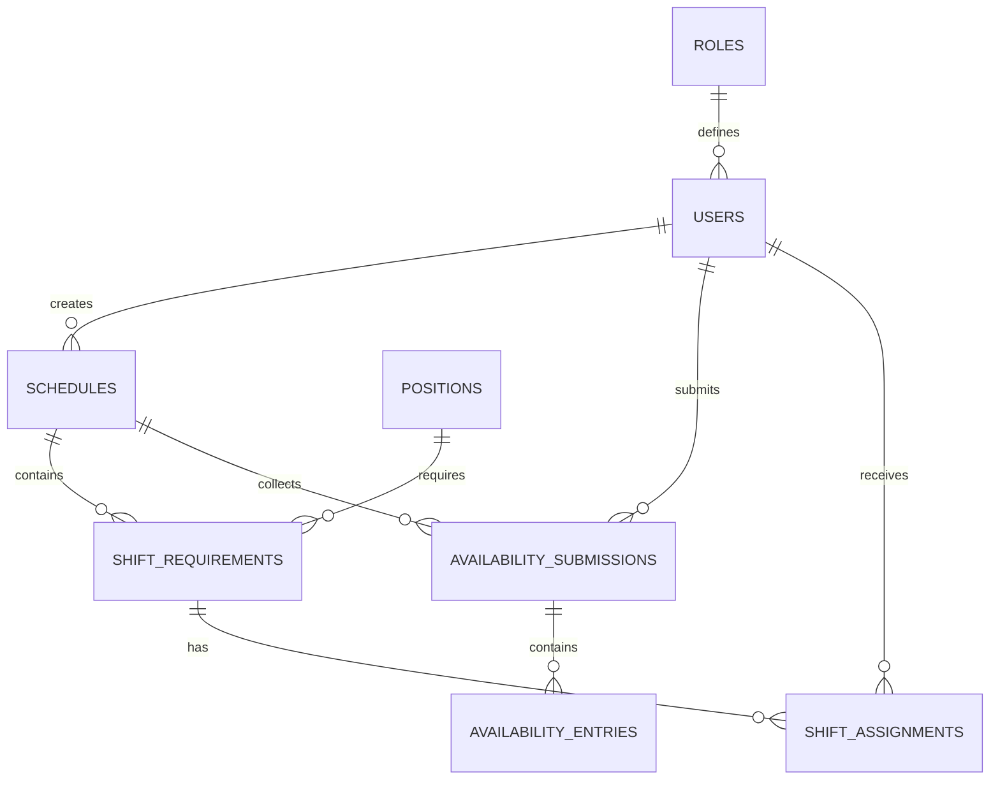

# DreamPlanner — model danych i reguły biznesowe

**Projekt:** DreamPlanner  
**Baza:** PostgreSQL (Azure Database for PostgreSQL — Flexible Server)  
**Autor części bazodanowej:** Maciej Grzegorski (DBA)  
**Etap:** projekt logiczny, baza do implementacji przez FastAPI / SQLAlchemy / Alembic

## 1. Cel

Aplikacja służy do przygotowywania miesięcznych grafików pracy. Menadżer definiuje stanowiska, godziny oraz zapotrzebowanie na pracowników, zbiera deklaracje dyspozycyjności, a następnie obsadza i publikuje grafik. Pracownicy widzą przydzielone zmiany dopiero po publikacji.

## 2. Role

| Rola | Zakres |
| --- | --- |
| `admin` | Tworzenie/dezaktywacja kont, nadawanie ról, zarządzanie słownikiem stanowisk |
| `manager` | Projekt grafiku, otwarcie/zamknięcie zbierania deklaracji, przydzielanie i publikacja |
| `employee` | Deklaracja własnej dyspozycyjności w otwartym okresie, podgląd opublikowanego grafiku |

MVP przewiduje jedną rolę na konto. Usuwanie użytkowników odbywa się przez dezaktywację konta (`is_active=false`), aby zachować historię.

## 3. Etapy grafiku

`draft` → `collecting` → `collection_closed` → `closed` → `published`

- **draft:** menadżer tworzy pozycje zapotrzebowania.
- **collecting:** pracownicy mogą edytować swoje deklaracje godzinowe i je wysłać.
- **collection_closed:** koniec zgłaszania; zgłoszenia są tylko do odczytu.
- **closed:** menadżer przydziela ludzi do zmian, uwzględniając ostrzeżenia.
- **published:** pracownicy widzą swoje zmiany.

Przejścia stanów oraz kontrola roli użytkownika są egzekwowane przez backend, a nie samą bazę.

## 4. Tabele

| Tabela | Rola | Kluczowe powiązania |
| --- | --- | --- |
| `roles` | Słownik uprawnień | `users.role_id` |
| `users` | Konta i dane pracowników | role, deklaracje, przydziały |
| `positions` | Słownik stanowisk | `shift_requirements.position_id` |
| `schedules` | Miesięczny grafik i jego etap | `created_by -> users` |
| `shift_requirements` | Potrzebna obsada na konkretną zmianę | `schedule_id`, `position_id` |
| `availability_submissions` | Stan przesłania deklaracji pracownika na miesiąc | `schedule_id`, `user_id` |
| `availability_entries` | Przedziały czasu dostępny/niedostępny | `submission_id` |
| `shift_assignments` | Przydziały ludzi do zmian | `shift_requirement_id`, `user_id`, `assigned_by` |

Jeden grafik przypada na parę (`year`, `month`). Jedno zgłoszenie dyspozycyjności przypada na pracownika i grafik. Jedna pozycja zapotrzebowania oznacza np. `2027-01-01 / Kuchnia / 08:00–16:00 / 2 osoby`.

## 5. Dyspozycyjność — wyłącznie konkretne godziny

- Pracownik zgłasza zakres `work_date`, `start_time`, `end_time` i `status` (`available` albo `unavailable`).
- `start_time < end_time`: nie obsługujemy zmian przechodzących przez północ.
- Zgłoszenia mogą zawierać wiele przedziałów dla różnych dni, ale nie mogą zachodzić na siebie w jednym dniu.
- `submitted_at` w `availability_submissions` oznacza przesłanie miesięcznej deklaracji. Pusta deklaracja i brak zgłoszenia to odrębne sytuacje.
- Brak wpisu dla danej zmiany **nie oznacza** zgody na pracę — to `unknown`.
- Status `available` dla całej zmiany wymaga pokrycia całego przedziału zmiany deklarowaną dostępnością. Jeśli brak pełnego pokrycia, status jest `unknown`, chyba że wpis `unavailable` zachodzi na zmianę — wtedy `unavailable`.
- Zadeklarowane `unavailable` ma pierwszeństwo przy konflikcie.

Przykład: pracownik zgłasza dostępność 09:00–15:00. Przy zmianie 08:00–16:00 system nie może uznać go za dostępnego przez całą zmianę.

## 6. Przypisywanie do zmian

Menadżer widzi przy pracowniku wynik porównania deklaracji i czasu zmiany:

| Wynik | Zachowanie aplikacji |
| --- | --- |
| `available` | Można przypisać bez dodatkowego ostrzeżenia |
| `unavailable` | Można przypisać dopiero po świadomym zatwierdzeniu ostrzeżenia |
| `unknown` | Można przypisać, lecz wpis zostaje oznaczony jako brak potwierdzonej dyspozycyjności |

W `shift_assignments` pola `warning_type` i `warning_acknowledged_at` dokumentują świadome potwierdzenie. **Backend** ma sprawdzić status dyspozycyjności w transakcji przed zapisem i w razie potrzeby wymusić potwierdzenie. Baza kontroluje spójność pary pól ostrzeżenia, ale sama nie wylicza statusu dostępności.

Baza odrzuca podwójne przypisanie tej samej osoby do tej samej zmiany i nakładające się czasowo przydziały w jednym dniu. Sprawdzanie maksymalnej obsady (`required_workers`) i uprawnień roli pozostaje regułą backendu.

## 7. Reguły integralności

- E-mail użytkownika jest unikalny bez względu na wielkość liter.
- Daty zmian i dyspozycyjności muszą należeć do miesiąca wybranego grafiku.
- `required_workers` jest liczbą dodatnią.
- Godzina zakończenia jest późniejsza niż godzina rozpoczęcia.
- Deklaracje jednej osoby w danym miesiącu nie nachodzą na siebie.
- Jeden użytkownik nie może dostać dwóch zachodzących na siebie przydziałów.

Uwaga implementacyjna: kontrola kolizji w triggerach jest pomocnicza; backend powinien wykonywać operacje atomowo i zapewnić zabezpieczenie przed równoczesnymi zapisami (np. blokady transakcyjne). W przypadku większego ruchu warto zastąpić te triggery ograniczeniami wykluczającymi zakresy czasu (`EXCLUDE USING gist`).

## 8. Integracja z backendem

- Framework: FastAPI, ORM: SQLAlchemy, migracje: Alembic.
- `schema.sql` stanowi **referencyjną specyfikację** modelu; wdrażany schemat i migracje Alembic muszą pozostać z nim spójne.
- Połączenie bazy tylko po stronie backendu, nigdy bezpośrednio z React.
- Hasła i connection string w zmiennych środowiskowych / bezpiecznym magazynie sekretów.
- Backend nie pokazuje nieopublikowanych przydziałów pracownikowi.

### Przykładowa odpowiedź API dla menadżera

```json
{
  "shift_id": 15,
  "work_date": "2027-01-01",
  "position": "Kuchnia",
  "start_time": "08:00:00",
  "end_time": "16:00:00",
  "required_workers": 2,
  "candidates": [
    {"user_id": 10, "full_name": "Anna", "availability": "available"},
    {"user_id": 11, "full_name": "Piotr", "availability": "unknown"},
    {"user_id": 12, "full_name": "Kasia", "availability": "unavailable"}
  ]
}
```

## 9. Zakres MVP i dalszy rozwój

MVP obejmuje jeden miesięczny grafik, jedną rolę na konto, godziny zmian w ramach jednej daty oraz przypisywanie pojedynczych osób. Nie obejmuje automatycznego układania grafiku, zmian nocnych, urlopów ani wielu oddziałów. Można je dodać później.

### Diagram relacji


