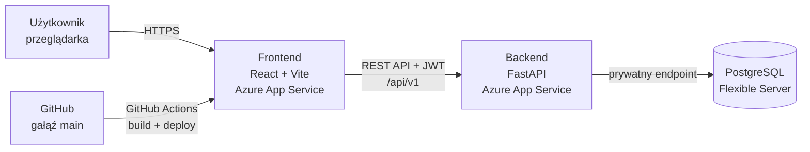
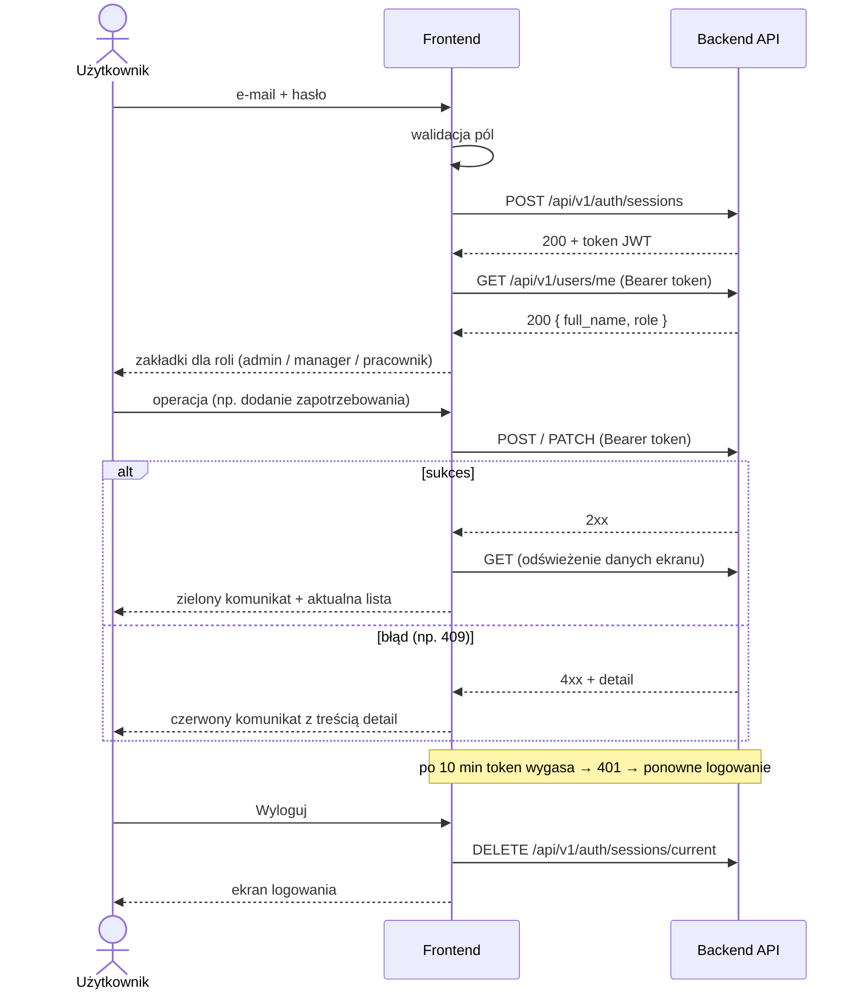
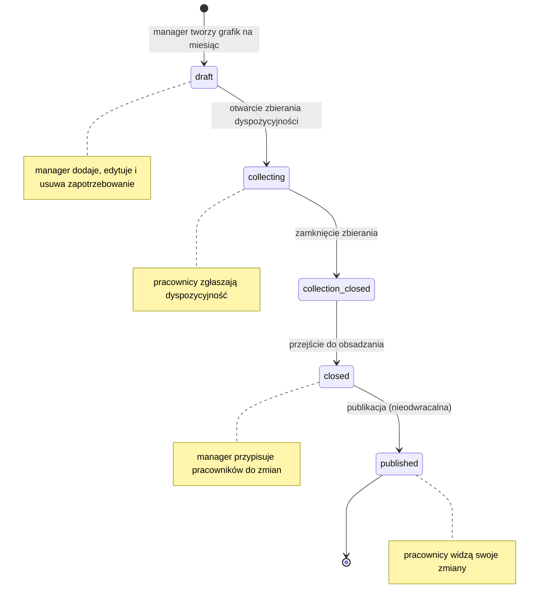

# DreamPlanner – Frontend

Aplikacja webowa DreamPlanner do planowania miesięcznych grafików pracy: od zapotrzebowania na pracowników, przez zbieranie dyspozycyjności, po obsadzenie zmian i publikację grafiku. Frontend łączy się z REST API backendu (FastAPI) i jest wdrożony w chmurze Microsoft Azure.

**Wersja produkcyjna:** https://app-dreamplanner-frontend-77076.azurewebsites.net

## Technologie

| Obszar | Technologia |
|---|---|
| Framework | React + TypeScript |
| Bundler / serwer deweloperski | Vite |
| Jakość kodu | ESLint, TypeScript (`tsc`) |
| Hosting | Azure App Service (kontener z `Dockerfile`) |
| CI/CD | GitHub Actions (build i deploy z gałęzi `main`, logowanie do Azure przez OIDC) |
| Backend | REST API (FastAPI) z prefiksem `/api/v1`, baza Azure Database for PostgreSQL |

## Architektura



## Struktura plików

```
frontend/
├── src/
│   ├── App.tsx                  # logowanie, profil użytkownika, zakładki zależne od roli
│   ├── LoginForm.tsx            # formularz logowania
│   ├── ActivationForm.tsx       # ustawienie hasła kodem aktywacyjnym / reaktywacji
│   ├── UsersPage.tsx            # admin: konta, role, kody aktywacyjne
│   ├── PositionsPage.tsx        # admin: CRUD stanowisk (manager: podgląd)
│   ├── SchedulesPage.tsx        # lista grafików, tworzenie i usuwanie szkicu
│   ├── ScheduleDetails.tsx      # szczegóły grafiku: etapy, zapotrzebowanie, obsada
│   ├── RequirementForm.tsx      # formularz zapotrzebowania (dodawanie i edycja)
│   ├── AvailabilityOverview.tsx # manager: podgląd zgłoszeń dyspozycyjności
│   ├── MyAvailabilityPage.tsx   # pracownik: zgłaszanie dyspozycyjności
│   ├── MyShiftsPage.tsx         # pracownik: zmiany z opublikowanych grafików
│   ├── api.ts                   # komunikacja z REST API (typy, token JWT, obsługa błędów)
│   ├── useLoader.ts             # hook: pobieranie danych ze stanem ładowania i błędu
│   ├── useApiAction.ts          # hook: operacje zapisu (zapisywanie / sukces / błąd)
│   ├── components.tsx          # wspólne elementy UI (komunikaty, spinner, zakładki)
│   ├── format.ts                # formatowanie dat, godzin, nazw statusów i ról
│   ├── validation.ts            # walidacja formularzy po stronie klienta
│   └── styles.ts                # wspólne style komponentów
├── Dockerfile
├── .env.local             # lokalna konfiguracja (NIE trafia do repozytorium)
└── package.json
```

## Uruchomienie lokalne

Wymagania: Node.js (wersja LTS) i npm.

```bash
cd frontend
npm install
```

Utwórz plik `.env.local` z adresem API:

```bash
VITE_API_BASE_URL=https://<adres-backendu>.azurewebsites.net/api/v1
```

Uruchom serwer deweloperski:

```bash
npm run dev
```

Aplikacja będzie dostępna pod adresem http://localhost:5173.

> Backend musi mieć `http://localhost:5173` na liście dozwolonych źródeł CORS, w przeciwnym razie przeglądarka zablokuje zapytania.

### Pozostałe komendy

| Komenda | Opis |
|---|---|
| `npm run dev` | serwer deweloperski z automatycznym przeładowaniem |
| `npm run build` | sprawdzenie typów (`tsc`) i build produkcyjny do `dist/` |
| `npm run lint` | analiza kodu ESLint |
| `npm run preview` | podgląd builda produkcyjnego lokalnie |

## Zmienne środowiskowe

| Zmienna | Opis | Przykład |
|---|---|---|
| `VITE_API_BASE_URL` | adres bazowy API **razem z** prefiksem `/api/v1` | `https://<adres-backendu>.azurewebsites.net/api/v1` |

Zmienne z prefiksem `VITE_` są wbudowywane w kod podczas `npm run build`, więc **nie wolno w nich trzymać sekretów** (haseł, kluczy). Plik `.env.local` jest w `.gitignore`.

## Endpointy API używane przez frontend

Wszystkie ścieżki mają prefiks `/api/v1`. Endpointy oznaczone 🔒 wymagają nagłówka `Authorization: Bearer <token>`. Pełna dokumentacja API jest dostępna w Swaggerze backendu pod adresem `/docs`.

### Logowanie i konto

| Metoda | Ścieżka | Opis | Rola | Funkcja w `api.ts` |
|---|---|---|---|---|
| `POST` | `/auth/sessions` | logowanie, zwraca token JWT | – | `login()` |
| `DELETE` 🔒 | `/auth/sessions/current` | wylogowanie | każda | `logout()` |
| `POST` | `/auth/activations` | ustawienie hasła kodem aktywacyjnym | – | `activateAccount()` |
| `POST` | `/auth/reactivations` | ustawienie hasła kodem reaktywacji | – | `activateAccount()` |
| `GET` 🔒 | `/users/me` | profil zalogowanego użytkownika (rola) | każda | `getCurrentUser()` |

### Użytkownicy i pracownicy

| Metoda | Ścieżka | Opis | Rola | Funkcja w `api.ts` |
|---|---|---|---|---|
| `GET` 🔒 | `/users` | lista kont | admin | `listUsers()` |
| `POST` 🔒 | `/users` | nowe konto (zwraca kod aktywacyjny) | admin | `createUser()` |
| `PUT` 🔒 | `/users/{id}/role` | zmiana roli | admin | `changeUserRole()` |
| `POST` 🔒 | `/users/{id}/deactivation` | dezaktywacja konta | admin | `deactivateUser()` |
| `POST` 🔒 | `/users/{id}/reactivation` | kod reaktywacji konta | admin | `reactivateUser()` |
| `POST` 🔒 | `/users/{id}/activation-tokens` | nowy kod aktywacyjny | admin | `reissueActivation()` |
| `GET` 🔒 | `/employees` | aktywni pracownicy (do obsady zmian) | manager, admin | `listEmployees()` |

### Stanowiska

| Metoda | Ścieżka | Opis | Rola | Funkcja w `api.ts` |
|---|---|---|---|---|
| `GET` 🔒 | `/positions?limit=100&sort=name` | lista stanowisk | admin, manager | `listPositions()` |
| `POST` 🔒 | `/positions` | dodanie stanowiska | admin | `createPosition()` |
| `PATCH` 🔒 | `/positions/{id}` | zmiana nazwy | admin | `renamePosition()` |
| `POST` 🔒 | `/positions/{id}/deactivation` | dezaktywacja | admin | `deactivatePosition()` |
| `POST` 🔒 | `/positions/{id}/reactivation` | ponowna aktywacja | admin | `reactivatePosition()` |

### Grafiki i zapotrzebowanie

| Metoda | Ścieżka | Opis | Rola | Funkcja w `api.ts` |
|---|---|---|---|---|
| `GET` 🔒 | `/schedules` | lista grafików | admin, manager | `listSchedules()` |
| `POST` 🔒 | `/schedules` | nowy grafik miesięczny (`draft`) | manager | `createSchedule()` |
| `GET` 🔒 | `/schedules/{id}` | szczegóły grafiku | admin, manager | `getSchedule()` |
| `DELETE` 🔒 | `/schedules/{id}` | usunięcie pustego szkicu | manager | `deleteSchedule()` |
| `POST` 🔒 | `/schedules/{id}/collection-opening` | `draft` → `collecting` | manager | `changeScheduleStatus()` |
| `POST` 🔒 | `/schedules/{id}/collection-closing` | `collecting` → `collection_closed` | manager | `changeScheduleStatus()` |
| `POST` 🔒 | `/schedules/{id}/closing` | `collection_closed` → `closed` | manager | `changeScheduleStatus()` |
| `POST` 🔒 | `/schedules/{id}/publication` | `closed` → `published` (nieodwracalne) | manager | `changeScheduleStatus()` |
| `GET` 🔒 | `/schedules/{id}/shift-requirements` | zapotrzebowanie grafiku | admin, manager | `listShiftRequirements()` |
| `POST` 🔒 | `/schedules/{id}/shift-requirements` | dodanie zapotrzebowania (tylko `draft`) | manager | `createShiftRequirement()` |
| `PATCH` 🔒 | `/schedules/{id}/shift-requirements/{rid}` | edycja zapotrzebowania (tylko `draft`) | manager | `updateShiftRequirement()` |
| `DELETE` 🔒 | `/schedules/{id}/shift-requirements/{rid}` | usunięcie zapotrzebowania (tylko `draft`) | manager | `deleteShiftRequirement()` |

### Obsada i dyspozycyjność

| Metoda | Ścieżka | Opis | Rola | Funkcja w `api.ts` |
|---|---|---|---|---|
| `GET` 🔒 | `/schedules/{id}/shift-assignments` | przydziały pracowników do zmian | admin, manager | `listAssignments()` |
| `POST` 🔒 | `/schedules/{id}/shift-assignments` | przypisanie pracownika (tylko `closed`) | manager | `createAssignment()` |
| `DELETE` 🔒 | `/schedules/{id}/shift-assignments/{aid}` | usunięcie przydziału (tylko `closed`) | manager | `deleteAssignment()` |
| `GET` 🔒 | `/schedules/{id}/availability-submissions` | zgłoszenia dyspozycyjności (pracownik: tylko własne) | każda | `listAvailability()` |
| `GET` 🔒 | `/schedules/{id}/availability-submissions/{sid}` | zgłoszenie z wpisami | każda | `getAvailability()` |
| `POST` 🔒 | `/schedules/{id}/availability-submissions` | nowe zgłoszenie (tylko `collecting`) | pracownik | `createAvailability()` |
| `PATCH` 🔒 | `/schedules/{id}/availability-submissions/{sid}` | edycja / przesłanie zgłoszenia | pracownik | `updateAvailability()` |
| `DELETE` 🔒 | `/schedules/{id}/availability-submissions/{sid}` | usunięcie wersji roboczej | pracownik | `deleteAvailability()` |
| `GET` 🔒 | `/me/shifts` | własne zmiany z opublikowanych grafików | pracownik | `listMyShifts()` |

Daty mają format `YYYY-MM-DD`, a godziny `HH:MM:SS` (czas lokalny `Europe/Warsaw`). Formularze używają pól `HH:MM`, a `api.ts` dopisuje sekundy.

### Format odpowiedzi listy

Listy są stronicowane (domyślnie 25 wyników, maksymalnie 100; frontend pobiera 100):

```json
{
  "items": [
    { "id": "string", "name": "Kuchnia", "is_active": true }
  ],
  "limit": 100,
  "offset": 0,
  "total": 1
}
```

### Format błędów

Backend zwraca błędy w formacie *problem details*. Frontend wyświetla użytkownikowi treść pola `detail`:

```json
{
  "type": "string",
  "title": "string",
  "status": 403,
  "detail": "Wymagana jest rola admin lub manager."
}
```

| Kod | Znaczenie | Zachowanie frontendu |
|---|---|---|
| – | brak połączenia z serwerem (sieć lub CORS) | „Brak połączenia z serwerem (sprawdź internet lub CORS).” |
| 401 | brak lub wygaśnięcie tokenu | komunikat „Sesja wygasła”, powrót do logowania |
| 403 | brak uprawnień dla roli użytkownika | komunikat z API |
| 404 | nie znaleziono zasobu | komunikat z API |
| 409 | konflikt ze stanem danych, np. duplikat nazwy, grafik dla tego miesiąca już istnieje, operacja niedozwolona w obecnym statusie grafiku, pełna obsada, nakładające się zmiany pracownika | komunikat z API |
| 409 `assignment-warning-required` | pracownik nie zgłosił dostępności w godzinach zmiany | okno potwierdzenia; po akceptacji ponowne wysłanie z `warning_acknowledged: true` |
| 422 | nieprawidłowe dane żądania | „Nieprawidłowe dane (pole: …)” z nazwą pola z `errors[].location` |
| 429 | zbyt wiele prób | prośba o ponowienie za chwilę |
| 500 / 503 | błąd serwera / brak konfiguracji JWT | komunikat z API zamiast pustej strony |

Jeśli odpowiedź nie zawiera pola `detail`, frontend pokazuje domyślny polski komunikat dla danego kodu (funkcja `describeError()` w `api.ts`).

## Logowanie i sesja

1. Użytkownik wpisuje e-mail i hasło. Frontend najpierw sprawdza poprawność pól.
2. Frontend wysyła dane do `POST /api/v1/auth/sessions`.
3. Backend zwraca token JWT (`access_token`) wraz z czasem ważności (`expires_in`, obecnie 10 minut).
4. Frontend pobiera profil (`GET /api/v1/users/me`) i na podstawie roli pokazuje odpowiednie zakładki.
5. Frontend przechowuje token na czas sesji i dołącza go do każdego zapytania w nagłówku `Authorization: Bearer`.
6. Gdy token wygaśnie (odpowiedź 401), użytkownik widzi komunikat o wygaśnięciu sesji i loguje się ponownie.
7. Przycisk „Wyloguj” wysyła `DELETE /api/v1/auth/sessions/current` i usuwa token z aplikacji.



## Role i ekrany

| Rola | Zakładki | Co może zrobić |
|---|---|---|
| **Administrator** | Użytkownicy, Stanowiska, Grafiki (podgląd) | zakłada konta managerów i pracowników, zmienia role, dezaktywuje konta, generuje kody aktywacyjne; zarządza stanowiskami; przegląda grafiki |
| **Manager** | Grafiki, Stanowiska (podgląd) | tworzy grafiki, definiuje zapotrzebowanie, prowadzi grafik przez kolejne etapy, przegląda dyspozycyjność, przypisuje pracowników, publikuje grafik |
| **Pracownik** | Moje zmiany, Moja dyspozycyjność | zgłasza dostępność w dniach i godzinach miesiąca, widzi swoje zmiany po publikacji |

Nowy użytkownik dostaje od administratora jednorazowy kod i na ekranie logowania („Aktywuj konto”) ustawia własne hasło.

## Cykl życia grafiku



| Etap (`status`) | W interfejsie | Dostępne operacje |
|---|---|---|
| `draft` | Szkic | dodawanie, edycja i usuwanie zapotrzebowania; usunięcie pustego grafiku |
| `collecting` | Zbieranie dyspozycyjności | pracownicy zapisują wersję roboczą i przesyłają zgłoszenie |
| `collection_closed` | Zbieranie zamknięte | manager przegląda zgłoszenia |
| `closed` | Obsadzanie zmian | przypisywanie i usuwanie pracowników; ostrzeżenie, gdy pracownik nie zgłosił dostępności |
| `published` | Opublikowany | tylko odczyt; zmiany widoczne w „Moje zmiany” |

## Funkcje interfejsu

- **Logowanie, wylogowanie i aktywacja konta** z walidacją pól (puste pola, format e-mail, zgodność haseł).
- **Użytkownicy** (admin): tworzenie kont, zmiana roli, dezaktywacja i reaktywacja, kody aktywacyjne z przyciskiem kopiowania.
- **Stanowiska** (admin): dodawanie, zmiana nazwy, dezaktywacja i ponowna aktywacja.
- **Grafiki** (manager): tworzenie grafiku na wybrany miesiąc, pasek etapów z przyciskiem przejścia do następnego, zapotrzebowanie (stanowisko, dzień, godziny, liczba osób, notatka), tabela „Zmiany i obsada” z licznikiem obsady i przypisanymi osobami, podgląd zgłoszeń dyspozycyjności z listą osób, które jeszcze nie przesłały.
- **Dyspozycyjność** (pracownik): wiele wpisów „dostępny / niedostępny”, wersja robocza, przesłanie, sprawdzanie nakładających się przedziałów.
- **Moje zmiany** (pracownik): zmiany z opublikowanych grafików z wyróżnieniem dzisiejszego dnia.
- **Stany interfejsu:** wskaźnik ładowania podczas zapytań, zielony komunikat po udanej operacji, czerwony komunikat z treścią błędu z API, potwierdzenia przed operacjami nieodwracalnymi.
- **Status API** na górze strony (czy backend i baza działają).

## Wdrożenie (CI/CD)

1. Zmiany powstają na osobnej gałęzi (np. `feat/frontend-crud`).
2. Przed pushem: `npm run lint` i `npm run build` muszą przejść bez błędów.
3. Pull Request do `main` i przegląd kodu przez zespół.
4. Po scaleniu GitHub Actions buduje obraz z `Dockerfile` i wdraża go na Azure App Service.
5. Status wdrożenia widać w zakładce **Actions** w repozytorium.

## Zespół

| Rola | Osoba |
|---|---|
| PM / DevOps | Kacper Polarczyk |
| Backend | Dawid Merchwa |
| Baza danych | Maciej Grzegorski |
| Frontend | Mikołaj Suchodolski |