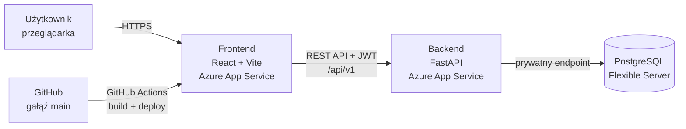
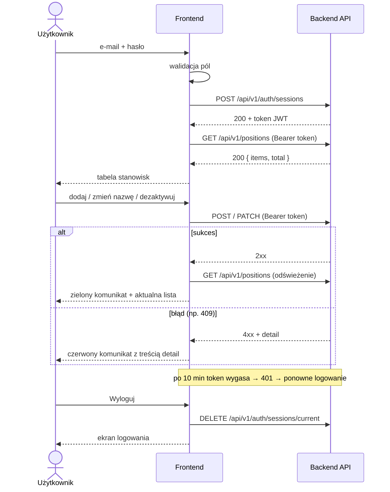

# DreamPlanner – Frontend

Aplikacja webowa DreamPlanner do zarządzania stanowiskami pracy. Frontend łączy się z REST API backendu (FastAPI) i jest wdrożony w chmurze Microsoft Azure.

**Wersja produkcyjna:** https://app-dreamplanner-frontend-77076.azurewebsites.net

## Technologie

| Obszar | Technologia |
|---|---|
| Framework | React + TypeScript |
| Bundler / serwer deweloperski | Vite |
| Jakość kodu | ESLint, TypeScript (`tsc`) |
| Hosting | Azure App Service (kontener z `Dockerfile`) |
| CI/CD | GitHub Actions (build i deploy z gałęzi `main`, logowanie do Azure przez OIDC) |
| Backend | REST API (FastAPI) z prefiksem `/api/v1`, baza Azure Database for PostgreSQL |

## Architektura



## Struktura plików

```
frontend/
├── src/
│   ├── App.tsx            # główny komponent: status API, logowanie / ekran stanowisk
│   ├── LoginForm.tsx      # formularz logowania
│   ├── PositionsPage.tsx  # lista stanowisk i operacje CRUD
│   ├── api.ts             # komunikacja z REST API (token JWT, obsługa błędów)
│   ├── validation.ts      # walidacja formularzy po stronie klienta
│   └── styles.ts          # wspólne style komponentów
├── Dockerfile
├── .env.local             # lokalna konfiguracja (NIE trafia do repozytorium)
└── package.json
```

## Uruchomienie lokalne

Wymagania: Node.js (wersja LTS) i npm.

```bash
cd frontend
npm install
```

Utwórz plik `.env.local` z adresem API:

```bash
VITE_API_BASE_URL=https://<adres-backendu>.azurewebsites.net/api/v1
```

Uruchom serwer deweloperski:

```bash
npm run dev
```

Aplikacja będzie dostępna pod adresem http://localhost:5173.

> Backend musi mieć `http://localhost:5173` na liście dozwolonych źródeł CORS, w przeciwnym razie przeglądarka zablokuje zapytania.

### Pozostałe komendy

| Komenda | Opis |
|---|---|
| `npm run dev` | serwer deweloperski z automatycznym przeładowaniem |
| `npm run build` | sprawdzenie typów (`tsc`) i build produkcyjny do `dist/` |
| `npm run lint` | analiza kodu ESLint |
| `npm run preview` | podgląd builda produkcyjnego lokalnie |

## Zmienne środowiskowe

| Zmienna | Opis | Przykład |
|---|---|---|
| `VITE_API_BASE_URL` | adres bazowy API **razem z** prefiksem `/api/v1` | `https://<adres-backendu>.azurewebsites.net/api/v1` |

Zmienne z prefiksem `VITE_` są wbudowywane w kod podczas `npm run build`, więc **nie wolno w nich trzymać sekretów** (haseł, kluczy). Plik `.env.local` jest w `.gitignore`.

## Endpointy API używane przez frontend

Wszystkie ścieżki mają prefiks `/api/v1`. Endpointy oznaczone 🔒 wymagają nagłówka `Authorization: Bearer <token>`. Pełna dokumentacja API jest dostępna w Swaggerze backendu pod adresem `/docs`.

| Metoda | Ścieżka | Opis | Funkcja w `api.ts` |
|---|---|---|---|
| `POST` | `/auth/sessions` | logowanie, zwraca token JWT (`access_token`, `expires_in`) | `login()` |
| `DELETE` 🔒 | `/auth/sessions/current` | wylogowanie (zakończenie bieżącej sesji) | `logout()` |
| `GET` 🔒 | `/positions?limit=100&sort=name` | lista stanowisk (aktywne i nieaktywne) | `listPositions()` |
| `POST` 🔒 | `/positions` | dodanie stanowiska | `createPosition()` |
| `PATCH` 🔒 | `/positions/{id}` | zmiana nazwy stanowiska | `renamePosition()` |
| `POST` 🔒 | `/positions/{id}/deactivation` | dezaktywacja stanowiska | `deactivatePosition()` |
| `POST` 🔒 | `/positions/{id}/reactivation` | ponowna aktywacja stanowiska | `reactivatePosition()` |

Operacje na stanowiskach wymagają roli **admin** lub **manager**. Inna rola dostaje odpowiedź 403.

### Format odpowiedzi listy

Lista jest stronicowana (domyślnie 25 wyników, maksymalnie 100):

```json
{
  "items": [
    { "id": "string", "name": "Kuchnia", "is_active": true }
  ],
  "limit": 100,
  "offset": 0,
  "total": 1
}
```

### Format błędów

Backend zwraca błędy w formacie *problem details*. Frontend wyświetla użytkownikowi treść pola `detail`:

```json
{
  "type": "string",
  "title": "string",
  "status": 403,
  "detail": "Wymagana jest rola admin lub manager."
}
```

| Kod | Znaczenie | Zachowanie frontendu |
|---|---|---|
| – | brak połączenia z serwerem (sieć lub CORS) | „Brak połączenia z serwerem (sprawdź internet lub CORS).” |
| 401 | brak lub wygaśnięcie tokenu | komunikat „Sesja wygasła”, powrót do logowania |
| 403 | brak uprawnień (rola inna niż admin/manager) | komunikat z API |
| 404 | nie znaleziono zasobu | komunikat z API |
| 409 | stanowisko o tej nazwie już istnieje | komunikat z API przy formularzu |
| 422 | nieprawidłowe dane żądania | „Nieprawidłowe dane (pole: …)” z nazwą pola z `errors[].location` |
| 429 | zbyt wiele prób | prośba o ponowienie za chwilę |
| 500 / 503 | błąd serwera / brak konfiguracji JWT | komunikat z API zamiast pustej strony |

Jeśli odpowiedź nie zawiera pola `detail`, frontend pokazuje domyślny polski komunikat dla danego kodu (funkcja `describeError()` w `api.ts`).

## Logowanie i sesja

1. Użytkownik wpisuje e-mail i hasło. Frontend najpierw sprawdza poprawność pól.
2. Frontend wysyła dane do `POST /api/v1/auth/sessions`.
3. Backend zwraca token JWT (`access_token`) wraz z czasem ważności (`expires_in`, obecnie 10 minut).
4. Frontend przechowuje token na czas sesji i dołącza go do każdego zapytania w nagłówku `Authorization: Bearer`.
5. Gdy token wygaśnie (odpowiedź 401), użytkownik widzi komunikat o wygaśnięciu sesji i loguje się ponownie.
6. Przycisk „Wyloguj” wysyła `DELETE /api/v1/auth/sessions/current` i usuwa token z aplikacji.



## Funkcje interfejsu

- **Logowanie i wylogowanie** z walidacją pól (puste pola, format e-mail).
- **Lista stanowisk** z nazwą i statusem (aktywne / nieaktywne).
- **Dodawanie stanowiska** z walidacją nazwy (pole nie może być puste).
- **Zmiana nazwy**, **dezaktywacja** i **ponowna aktywacja** stanowiska.
- **Stany interfejsu:** wskaźnik ładowania podczas zapytań, zielony komunikat po udanej operacji, czerwony komunikat z treścią błędu z API.
- **Status API** na górze strony (czy backend i baza działają).

## Wdrożenie (CI/CD)

1. Zmiany powstają na osobnej gałęzi (np. `feat/frontend-crud`).
2. Przed pushem: `npm run lint` i `npm run build` muszą przejść bez błędów.
3. Pull Request do `main` i przegląd kodu przez zespół.
4. Po scaleniu GitHub Actions buduje obraz z `Dockerfile` i wdraża go na Azure App Service.
5. Status wdrożenia widać w zakładce **Actions** w repozytorium.

## Zespół

| Rola | Osoba |
|---|---|
| PM / DevOps | Kacper Polarczyk |
| Backend | Dawid Merchwa |
| Baza danych | Maciej Grzegorski |
| Frontend | Mikołaj Suchodolski |